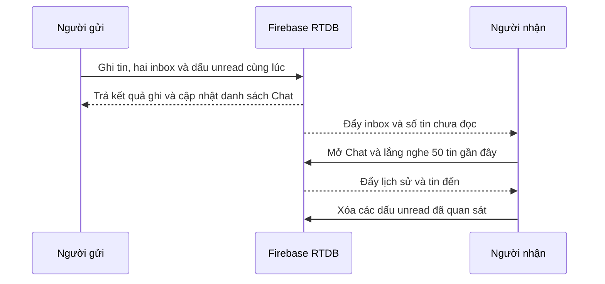

# Kiến trúc và dữ liệu

React Native CLI dựng cây React Navigation. App.tsx quản lý phiên, danh bạ và inbox rồi truyền dữ liệu qua props. Màn Chat tự đăng ký listener theo phòng. Các truy cập Firebase tập trung trong src/services. Mỗi nhóm luồng giữ state gần nơi sử dụng. Dữ liệu chat phân trang 50 tin, sắp xếp theo thời gian máy chủ và dùng khóa push để phá hòa. Listener có callback lỗi và hàm unsubscribe. Presence theo từng kết nối, đặt onDisconnect trước khi ghi online. Kết nối của tài khoản dùng trên thiết bị khác vẫn online khi một thiết bị rời đi.

| Đường dẫn | Nội dung | Truy cập dự kiến |
| --- | --- | --- |
| profiles/{uid} | name công khai, không gồm email | Thành viên đã xác thực đọc, chủ sở hữu ghi |
| presence/{uid}/{connectionId} | true cho kết nối hiện hành và khóa `typing_{peerId}` khi đang nhập | Thành viên đọc, chủ sở hữu quản lý kết nối và trạng thái nhập |
| chats/{lowerUid}/{higherUid}/messages/{messageId} | senderId, kind, createdAt và text hoặc tọa độ | Hai thành viên đọc, tác giả tạo tin |
| inbox/{uid}/{peerId} | Bản sao tin gần nhất và id | Chủ hộp thư đọc, hai thành viên ghi theo quy tắc |
| unread/{uid}/{peerId}/{messageId} | Thời gian máy chủ của mỗi tin chưa đọc cho người nhận | Người gửi tạo theo danh tính, người nhận đọc/xóa |

Tin nhắn dùng serverTimestamp. Gửi tin dùng cập nhật đa đường dẫn cho tin, hai tóm tắt hộp thư và một dấu chưa đọc. Trạng thái đang nhập được đồng bộ thời gian thực qua `presence/{uid}/typing_{peerId}` (giá trị `true`, đăng ký `onDisconnect().remove()`), tự tắt sau 12 giây không nhập, khi xóa trống nội dung, khi gửi tin, khi mất focus hoặc khi rời phòng chat; màn Chat đăng ký `subscribeTyping` để hiển thị bong bóng 3 chấm đang nhập. Khi mở phòng, dùng thời gian và mã tin mới nhất đã quan sát để truy vấn rồi xóa các dấu chưa đọc đến mốc đó. Trong lúc phòng có focus, chỉ xóa dấu theo mã tin mới đã nhận. Dùng mã tin tránh mất số đếm khi thao tác đọc trùng lúc gửi. Giới hạn dữ liệu đầu vào tại service và Rules. Danh bạ là tập nhỏ của bài thực hành, quét cục bộ bằng tên chuẩn hóa. Component hàng danh sách giữ key ổn định. Tọa độ latitude [-90, 90], longitude [-180, 180]. Chỉ chứa email trong Firebase Auth. Rules kiểm tra người gửi đúng theo Auth, cả hai tài khoản có hồ sơ, tin và ba bản ghi chỉ mục cùng xuất hiện trong một cập nhật, chỉ người nhận được xóa dấu đã đọc. Rules giới hạn tin văn bản ở 4.000 ký tự và chặn tin chỉ chứa dấu cách, tab, CR hoặc LF. Ứng dụng kiểm tra chuỗi sau trim trước khi gửi. Firebase lưu phiên đăng nhập qua AsyncStorage. Khi Auth trở về trước lúc hồ sơ ghi xong, cổng phiên đợi hoàn tất đăng ký.

## Môi trường

- Demo cục bộ chạy Firebase Emulator cho Auth và RTDB, dữ liệu được tạo bằng tài khoản giả. Android kết nối qua adb reverse hoặc địa chỉ host 10.0.2.2.
- App mặc định nối dự án APPTH05 qua Web client config, dùng Auth Email/Password và RTDB vùng asia-southeast1. Quyền đọc/ghi dựa vào Auth và Rules trong database.rules.json.
- Màn Thông báo và Rules gốc Bài 4/5 cần được đối chiếu khi có các nguồn này.

Tài liệu tham chiếu [Firebase JS SDK trên React Native](https://firebase.blog/posts/2023/03/which-react-native-firebase-sdk-to-use) và [Firebase presence](https://firebase.google.com/docs/database/web/offline-capabilities).

## Luồng gửi và đọc tin

